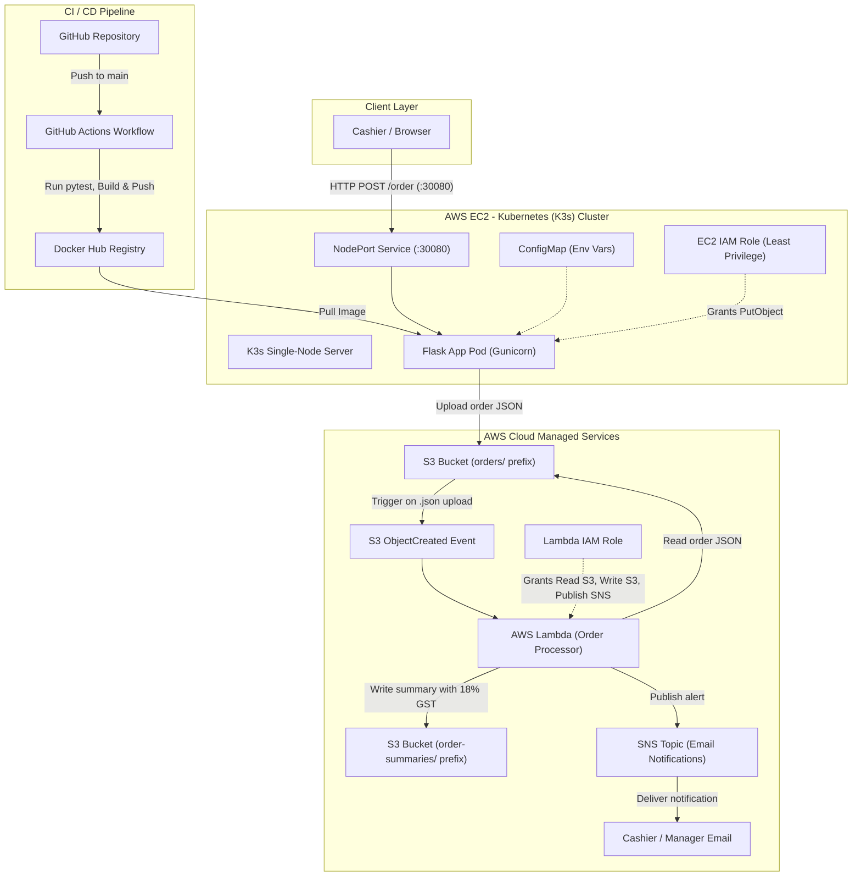

# ☕ Cloud Café Order Processor

A production-style, cloud-native full-stack project demonstrating how modern cloud services, containerization, and Kubernetes interact seamlessly.

A cashier places a customer order through a responsive Flask web application. The order is stored as JSON in Amazon S3, triggering an automated serverless AWS Lambda workflow that calculates taxes (18% GST), writes processed order summaries, and sends instant email alerts via Amazon Simple Notification Service (SNS). The application is containerized with Docker, automated with GitHub Actions CI/CD, and deployed onto a lightweight Kubernetes (K3s) cluster hosted on AWS EC2.

---

## 🏗️ Architecture Diagram



---

## 🛠️ Technologies Used

| Technology | Role & Purpose |
|---|---|
| **Python 3.12 + Flask** | Web application framework for cashier order creation and S3 upload |
| **Gunicorn** | Production WSGI HTTP server running Flask |
| **Git & GitHub** | Version control and collaborative code hosting |
| **GitHub Actions** | Automated CI/CD pipeline to test, build, and push Docker images |
| **Docker** | Containerization packaging the application and runtime dependencies |
| **Docker Hub** | Public/private container registry storing built container images |
| **Amazon S3** | Object storage holding raw orders (`orders/`) and final summaries (`order-summaries/`) |
| **AWS Lambda** | Serverless compute executing business logic (18% GST tax calculation) |
| **AWS SNS** | Pub/Sub messaging service delivering order completion emails |
| **AWS IAM** | Least-privilege roles and policies securing EC2, Flask, and Lambda |
| **AWS EC2** | Virtual machine hosting the Kubernetes environment |
| **Kubernetes (K3s)** | Lightweight, CNCF-certified Kubernetes distribution orchestrating the container |
| **Terraform** | Infrastructure as Code (IaC) provisioning AWS infrastructure automatically |

---

## 📁 Project Structure

```text
cloud-cafe-order-processor/
├── app.py                      # Flask web application & S3 upload logic
├── requirements.txt            # Python dependencies (Flask, boto3, gunicorn, etc.)
├── Dockerfile                  # Container definition using Python 3.12-slim & Gunicorn
├── .dockerignore               # Files excluded from Docker builds
├── .gitignore                  # Git untracked patterns
├── .env.example                # Sample environment variables template
├── README.md                   # Comprehensive guide and documentation
├── templates/
│   ├── index.html              # Clean café order interface
│   └── success.html            # Order receipt and confirmation page
├── lambda/
│   ├── lambda_function.py      # Event-driven handler (calculates 18% GST, notifies SNS)
│   └── requirements.txt        # Lambda dependencies
├── k8s/
│   ├── deployment.yaml         # Kubernetes Deployment manifest (probes, resources)
│   ├── service.yaml            # NodePort Service manifest (port 30080)
│   └── configmap.yaml          # ConfigMap for runtime environment settings
├── terraform/
│   ├── main.tf                 # S3, Lambda, SNS, and notification trigger configuration
│   ├── variables.tf            # Configurable Terraform input variables
│   ├── outputs.tf              # Exported resource ARNs and identifiers
│   └── iam.tf                  # Least-privilege IAM roles and policies
├── tests/
│   ├── __init__.py             # Test package marker
│   ├── test_app.py             # Unit & integration tests for Flask app (mocked with moto)
│   └── test_lambda.py          # Unit & integration tests for Lambda handler (mocked with moto)
└── .github/
    └── workflows/
        └── docker-publish.yml  # GitHub Actions CI/CD pipeline
```

---

## 📋 Order ID & Data Specifications

### 1. Order ID Format
Generated dynamically upon order placement:
`ORD-YYYYMMDD-HHMMSS-XXXX`
- `YYYYMMDD`: Current UTC date (e.g., `20261115`)
- `HHMMSS`: Current UTC time (e.g., `214530`)
- `XXXX`: 4 random alphanumeric uppercase characters (e.g., `9A4K`)

### 2. Original Order JSON (`orders/<order_id>.json`)
```json
{
  "order_id": "ORD-20261115-214530-9A4K",
  "created_at": "2026-11-15T21:45:30.123456",
  "customer_name": "Jane Doe",
  "selected_items": [
    { "name": "Coffee", "price": 4.50 },
    { "name": "Sandwich", "price": 8.00 }
  ],
  "subtotal": 12.50,
  "status": "NEW"
}
```

### 3. Processed Summary JSON (`order-summaries/<order_id>-summary.json`)
```json
{
  "order_id": "ORD-20261115-214530-9A4K",
  "customer_name": "Jane Doe",
  "subtotal": 12.50,
  "gst_rate": 18,
  "gst_amount": 2.25,
  "final_total": 14.75,
  "processed_at": "2026-11-15T21:45:32.654321",
  "order_status": "PROCESSED"
}
```

---

## 🚀 Getting Started Locally

### Prerequisites
- **Python 3.12+**
- **Docker Engine**
- **Git**
- **AWS CLI** configured (`aws configure`)

### 1. Clone the Repository
```bash
git clone https://github.com/YOUR_USERNAME/cloud-cafe-order-processor.git
cd cloud-cafe-order-processor
```

### 2. Create a Virtual Environment and Install Dependencies
```bash
# macOS/Linux
python3 -m venv venv
source venv/bin/activate

# Windows (PowerShell)
python -m venv venv
.\venv\Scripts\Activate.ps1

# Install requirements
pip install -r requirements.txt
```

### 3. Configure Local Environment Variables
Copy `.env.example` to `.env`:
```bash
cp .env.example .env
```
Edit `.env` with your desired configuration:
```env
AWS_REGION=us-east-1
S3_BUCKET_NAME=your-unique-cloud-cafe-orders-bucket
FLASK_ENV=development
FLASK_DEBUG=1
SECRET_KEY=local-dev-secret
```

### 4. Run the Flask Web Application
```bash
python app.py
```
Open your browser and navigate to `http://localhost:5000`.

### 5. Run the Test Suite
The project includes unit and integration tests powered by `pytest` and `moto` (which mocks AWS services in-memory without hitting actual AWS infrastructure):
```bash
python -m pytest tests/ -v
```

---

## 🐳 Docker Setup

### 1. Build the Docker Image
```bash
docker build -t cloud-cafe-order-processor:latest .
```

### 2. Run the Container Locally
Pass your AWS credentials or test variables into the container:
```bash
docker run -d -p 5000:5000 \
  --name cloud-cafe \
  -e AWS_REGION=us-east-1 \
  -e S3_BUCKET_NAME=your-unique-cloud-cafe-orders-bucket \
  -e AWS_ACCESS_KEY_ID=your_access_key \
  -e AWS_SECRET_ACCESS_KEY=your_secret_key \
  cloud-cafe-order-processor:latest
```
Check container logs:
```bash
docker logs -f cloud-cafe
```
Visit `http://localhost:5000` to verify the container is serving requests.

### 3. Push to Docker Hub
```bash
# Log in to Docker Hub
docker login

# Tag the image with your Docker Hub username
docker tag cloud-cafe-order-processor:latest YOUR_DOCKERHUB_USERNAME/cloud-cafe-order-processor:latest

# Push the image
docker push YOUR_DOCKERHUB_USERNAME/cloud-cafe-order-processor:latest
```

---

## 🔄 CI/CD Pipeline (GitHub Actions)

The `.github/workflows/docker-publish.yml` workflow automatically runs on every `push` and `pull_request` targeting the `main` branch.

### How it Works:
1. **Test Job**:
   - Checks out the repository.
   - Sets up Python 3.12.
   - Installs dependencies.
   - Runs `pytest tests/ -v` against mocked AWS infrastructure.
2. **Build and Push Job** (Runs only on push to `main`):
   - Sets up Docker Buildx.
   - Authenticates with Docker Hub using repository secrets.
   - Builds the production image.
   - Pushes two tags: `:latest` and `:<commit-sha>`.

### Configuring GitHub Secrets:
In your GitHub repository, navigate to **Settings > Secrets and variables > Actions** and add:
- `DOCKERHUB_USERNAME`: Your Docker Hub account username.
- `DOCKERHUB_TOKEN`: A Docker Hub Personal Access Token (PAT) with Read/Write permissions.

---

## ☁️ AWS Cloud Infrastructure Setup

You can provision all AWS infrastructure using either **Terraform (recommended)** or the **AWS CLI**.

---

### Option A: Automated Provisioning with Terraform (Recommended)

All infrastructure files are located under `terraform/`:
- `main.tf`: S3 bucket, server-side encryption, public access block, SNS topic, email subscription, Lambda function, and S3 event trigger.
- `iam.tf`: Least-privilege IAM roles for Lambda and EC2.
- `variables.tf`: Input configurations.
- `outputs.tf`: Outputs ARNs and names for verification.

#### Steps:
```bash
cd terraform

# 1. Initialize Terraform plugins
terraform init

# 2. Plan deployment (provide your email and unique bucket name)
terraform plan \
  -var="sns_email=your-email@example.com" \
  -var="s3_bucket_name=cloud-cafe-orders-YOUR-UNIQUE-SUFFIX" \
  -var="aws_region=us-east-1"

# 3. Apply infrastructure
terraform apply \
  -var="sns_email=your-email@example.com" \
  -var="s3_bucket_name=cloud-cafe-orders-YOUR-UNIQUE-SUFFIX" \
  -var="aws_region=us-east-1" -auto-approve
```

> [!IMPORTANT]
> Check your email inbox for an **AWS Notification - Subscription Confirmation** email and click the confirmation link to activate SNS notifications.

---

### Option B: Step-by-Step Manual Setup with AWS CLI

#### Step 1: Create an S3 Bucket
```bash
export BUCKET_NAME="cloud-cafe-orders-YOUR-UNIQUE-SUFFIX"
export REGION="us-east-1"

aws s3api create-bucket \
  --bucket $BUCKET_NAME \
  --region $REGION

# Block all public access
aws s3api put-public-access-block \
  --bucket $BUCKET_NAME \
  --public-access-block-configuration "BlockPublicAcls=true,IgnorePublicAcls=true,BlockPublicPolicy=true,RestrictPublicBuckets=true"
```

#### Step 2: Create SNS Topic and Subscribe Email
```bash
# Create SNS Topic
aws sns create-topic --name cloud-cafe-order-notifications --region $REGION

export TOPIC_ARN=$(aws sns list-topics --query "Topics[?contains(TopicArn, 'cloud-cafe-order-notifications')].TopicArn" --output text)

# Subscribe your email
aws sns subscribe \
  --topic-arn $TOPIC_ARN \
  --protocol email \
  --notification-endpoint "your-email@example.com" \
  --region $REGION
```
*Confirm the subscription via the confirmation email in your inbox.*

#### Step 3: Create IAM Role for Lambda
Create trust policy file `lambda-trust.json`:
```json
{
  "Version": "2012-10-17",
  "Statement": [
    {
      "Effect": "Allow",
      "Principal": { "Service": "lambda.amazonaws.com" },
      "Action": "sts:AssumeRole"
    }
  ]
}
```
Create the role:
```bash
aws iam create-role \
  --role-name cloud-cafe-lambda-role \
  --assume-role-policy-document file://lambda-trust.json

export LAMBDA_ROLE_ARN=$(aws iam get-role --role-name cloud-cafe-lambda-role --query 'Role.Arn' --output text)
```

Create permission policy file `lambda-policy.json`:
```json
{
  "Version": "2012-10-17",
  "Statement": [
    {
      "Effect": "Allow",
      "Action": ["s3:GetObject"],
      "Resource": "arn:aws:s3:::YOUR-BUCKET-NAME/orders/*"
    },
    {
      "Effect": "Allow",
      "Action": ["s3:PutObject"],
      "Resource": "arn:aws:s3:::YOUR-BUCKET-NAME/order-summaries/*"
    },
    {
      "Effect": "Allow",
      "Action": ["sns:Publish"],
      "Resource": "YOUR-SNS-TOPIC-ARN"
    },
    {
      "Effect": "Allow",
      "Action": [
        "logs:CreateLogGroup",
        "logs:CreateLogStream",
        "logs:PutLogEvents"
      ],
      "Resource": "*"
    }
  ]
}
```
Attach policy:
```bash
aws iam put-role-policy \
  --role-name cloud-cafe-lambda-role \
  --policy-name cloud-cafe-lambda-policy \
  --policy-document file://lambda-policy.json
```

#### Step 4: Package and Deploy Lambda Function
```bash
cd lambda
zip lambda_function.zip lambda_function.py

aws lambda create-function \
  --function-name cloud-cafe-order-processor \
  --runtime python3.12 \
  --role $LAMBDA_ROLE_ARN \
  --handler lambda_function.lambda_handler \
  --zip-file fileb://lambda_function.zip \
  --timeout 30 \
  --region $REGION \
  --environment "Variables={S3_BUCKET_NAME=$BUCKET_NAME,SNS_TOPIC_ARN=$TOPIC_ARN,AWS_REGION=$REGION}"

export LAMBDA_ARN=$(aws lambda get-function --function-name cloud-cafe-order-processor --query 'Configuration.FunctionArn' --output text)
cd ..
```

#### Step 5: Configure S3 Event Notification Trigger
Grant S3 permission to invoke Lambda:
```bash
aws lambda add-permission \
  --function-name cloud-cafe-order-processor \
  --statement-id s3-trigger-orders \
  --action lambda:InvokeFunction \
  --principal s3.amazonaws.com \
  --source-arn "arn:aws:s3:::$BUCKET_NAME"
```

Create notification config `s3-notification.json`:
```json
{
  "LambdaFunctionConfigurations": [
    {
      "LambdaFunctionArn": "REPLACE_WITH_LAMBDA_ARN",
      "Events": ["s3:ObjectCreated:*"],
      "Filter": {
        "Key": {
          "FilterRules": [
            { "Name": "prefix", "Value": "orders/" },
            { "Name": "suffix", "Value": ".json" }
          ]
        }
      }
    }
  ]
}
```
Apply notification configuration:
```bash
aws s3api put-bucket-notification-configuration \
  --bucket $BUCKET_NAME \
  --notification-configuration file://s3-notification.json
```

#### Step 6: Create EC2 IAM Role for Flask Application
Create trust policy `ec2-trust.json`:
```json
{
  "Version": "2012-10-17",
  "Statement": [
    {
      "Effect": "Allow",
      "Principal": { "Service": "ec2.amazonaws.com" },
      "Action": "sts:AssumeRole"
    }
  ]
}
```
Create role and instance profile:
```bash
aws iam create-role \
  --role-name cloud-cafe-ec2-role \
  --assume-role-policy-document file://ec2-trust.json

# Attach least-privilege inline policy (upload orders to S3)
cat <<EOF > ec2-policy.json
{
  "Version": "2012-10-17",
  "Statement": [
    {
      "Effect": "Allow",
      "Action": ["s3:PutObject", "s3:GetObject"],
      "Resource": "arn:aws:s3:::$BUCKET_NAME/orders/*"
    }
  ]
}
EOF

aws iam put-role-policy \
  --role-name cloud-cafe-ec2-role \
  --policy-name cloud-cafe-ec2-policy \
  --policy-document file://ec2-policy.json

aws iam create-instance-profile --instance-profile-name cloud-cafe-ec2-profile
aws iam add-role-to-instance-profile --instance-profile-name cloud-cafe-ec2-profile --role-name cloud-cafe-ec2-role
```

---

## 🖥️ EC2 and K3s Deployment Guide

### 1. Launch EC2 Instance
- **AMI**: Ubuntu 22.04 LTS (HVM)
- **Instance Type**: `t3.medium` (recommended for running K3s)
- **IAM Role**: Attach `cloud-cafe-ec2-profile`
- **Security Group Inbound Rules**:
  - `SSH (22)`: Your IP
  - `HTTP (80)`: Anywhere (0.0.0.0/0)
  - `Custom TCP (30080)`: Anywhere (0.0.0.0/0) - for NodePort service access

### 2. Connect to EC2 and Install K3s
SSH into your instance:
```bash
ssh -i your-key.pem ubuntu@<EC2_PUBLIC_IP>
```

Install K3s (lightweight single-node Kubernetes):
```bash
# Install K3s
curl -sfL https://get.k3s.io | sh -

# Allow ubuntu user to run kubectl commands without sudo
sudo chmod 644 /etc/rancher/k3s/k3s.yaml
export KUBECONFIG=/etc/rancher/k3s/k3s.yaml
echo "export KUBECONFIG=/etc/rancher/k3s/k3s.yaml" >> ~/.bashrc

# Verify cluster status
kubectl get nodes
```

### 3. Deploy the Application Manifests
Clone the repository on the EC2 instance or copy the `k8s/` folder:
```bash
git clone https://github.com/YOUR_USERNAME/cloud-cafe-order-processor.git
cd cloud-cafe-order-processor
```

Update `k8s/configmap.yaml` with your actual S3 bucket name:
```bash
sed -i 's/cloud-cafe-orders-YOUR-UNIQUE-SUFFIX/your-actual-bucket-name/g' k8s/configmap.yaml
```

Update `k8s/deployment.yaml` with your Docker Hub username:
```bash
sed -i 's/YOUR_DOCKERHUB_USERNAME/your-dockerhub-user/g' k8s/deployment.yaml
```

Apply the Kubernetes manifests:
```bash
kubectl apply -f k8s/configmap.yaml
kubectl apply -f k8s/deployment.yaml
kubectl apply -f k8s/service.yaml
```

Check rollout status:
```bash
kubectl get pods -w
kubectl get svc
```

### 4. Access the Application
Open your web browser and navigate to:
```
http://<EC2_PUBLIC_IP>:30080
```

---

## ✅ End-to-End Verification

Follow these steps to verify that every component functions properly:

### 1. Place an Order
1. Open `http://<EC2_PUBLIC_IP>:30080` in your browser.
2. Enter a Customer Name (e.g., `Alex Mercer`).
3. Select menu items (e.g., `Coffee` + `Sandwich`).
4. Click **Place Order**.
5. You should be redirected to the success screen displaying your unique Order ID (e.g., `ORD-20261115-214530-9A4K`) and Subtotal (`$12.50`).

### 2. Verify Original Order in S3
Check that the raw JSON file was written to the `orders/` prefix:
```bash
aws s3 ls s3://<YOUR_BUCKET_NAME>/orders/
aws s3 cp s3://<YOUR_BUCKET_NAME>/orders/<ORDER_ID>.json -
```

### 3. Verify Lambda Processing & Summary in S3
Check that Lambda was triggered and created the summary JSON under `order-summaries/`:
```bash
aws s3 ls s3://<YOUR_BUCKET_NAME>/order-summaries/
aws s3 cp s3://<YOUR_BUCKET_NAME>/order-summaries/<ORDER_ID>-summary.json -
```
Verify the output contains:
- `gst_rate: 18`
- `gst_amount: 2.25`
- `final_total: 14.75`
- `order_status: "PROCESSED"`

### 4. Verify SNS Email Notification
Open the email account subscribed to the SNS topic. You should see an email with:
- **Subject**: `Order Processed: ORD-...`
- **Body**: Order ID, Customer Name, Subtotal, 18% GST amount, and Final Total.

### 5. Check CloudWatch Logs for Lambda
```bash
aws logs describe-log-groups --log-group-name-prefix /aws/lambda/cloud-cafe-order-processor
aws logs tail /aws/lambda/cloud-cafe-order-processor --follow
```

---

## 🔒 Security Best Practices Implemented

- **Zero Hardcoded Credentials**: No AWS access keys, secret keys, or passwords exist anywhere in source code.
- **IAM Roles & Instance Profiles**: EC2 instances and Lambda functions utilize IAM assume roles with short-lived STS credentials.
- **Strict Least Privilege**:
  - Flask application on EC2 can only `PutObject` and `GetObject` on `orders/*`.
  - Lambda execution role can only read `orders/*`, write `order-summaries/*`, and `Publish` to the designated SNS topic.
- **Environment Isolation**: `.env` and `.tfstate` files are excluded via `.gitignore` and `.dockerignore`.
- **Public Access Protection**: S3 bucket has `BlockPublicAccess` enabled with server-side encryption (`AES256`).

---

## 🧹 Teardown & Resource Cleanup

To prevent ongoing cloud charges when you are done testing:

### If using Terraform:
```bash
cd terraform
terraform destroy \
  -var="sns_email=your-email@example.com" \
  -var="s3_bucket_name=cloud-cafe-orders-YOUR-UNIQUE-SUFFIX" \
  -auto-approve
```

### If using AWS CLI:
```bash
# 1. Empty and delete S3 bucket
aws s3 rm s3://$BUCKET_NAME --recursive
aws s3api delete-bucket --bucket $BUCKET_NAME

# 2. Delete Lambda function
aws lambda delete-function --function-name cloud-cafe-order-processor

# 3. Delete SNS topic
aws sns delete-topic --topic-arn $TOPIC_ARN

# 4. Remove IAM roles & instance profiles
aws iam remove-role-from-instance-profile --instance-profile-name cloud-cafe-ec2-profile --role-name cloud-cafe-ec2-role
aws iam delete-instance-profile --instance-profile-name cloud-cafe-ec2-profile
aws iam delete-role-policy --role-name cloud-cafe-ec2-role --policy-name cloud-cafe-ec2-policy
aws iam delete-role --role-name cloud-cafe-ec2-role

aws iam delete-role-policy --role-name cloud-cafe-lambda-role --policy-name cloud-cafe-lambda-policy
aws iam delete-role --role-name cloud-cafe-lambda-role

# 5. Terminate EC2 instance
aws ec2 terminate-instances --instance-ids <YOUR_INSTANCE_ID>
```

---

## 📄 License
This project is licensed under the [MIT License](LICENSE).
